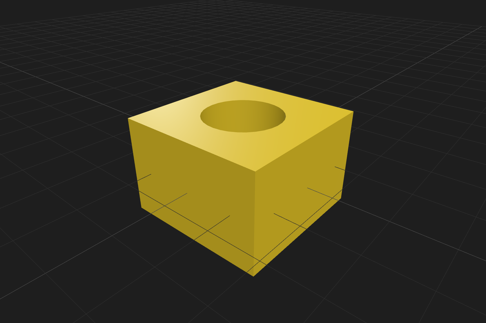
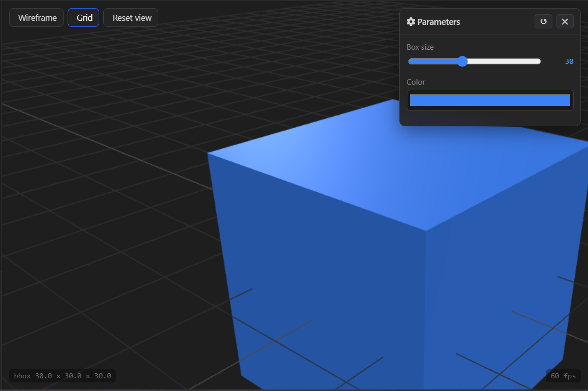
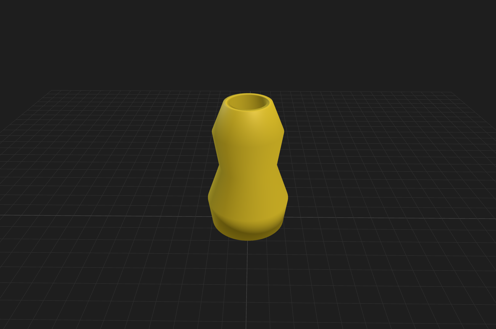
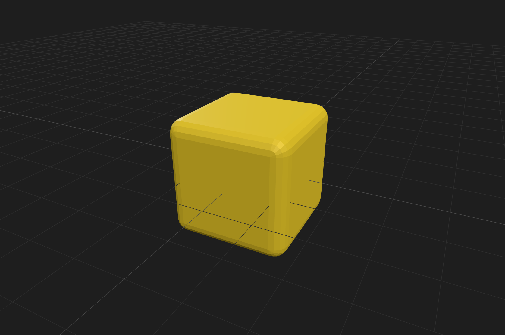

# Mini OpenSCAD

> Miniature CAD tool di browser — tulis OpenSCAD, lihat hasil 3D secara real-time.

Editor OpenSCAD ringan yang berjalan 100% di browser. Tidak butuh install, tidak butuh GPU khusus, tidak butuh koneksi setelah first load. Cukup buka browser dan mulai model.

   

---

## 📚 Documentation

| Dokumen | Deskripsi |
|:---|:---|
| [🏗️ Arsitektur & Design Principles](./docs-md/architecture.md) | Struktur proyek, prinsip desain, Worker boundary, Data-driven UI |
| [🧪 Testing & Sanity Checklist](./docs-md/testing.md) | Checklist manual fitur bahasa & tool |
| [🌐 Deploy Guide](./docs-md/deploy.md) | Netlify, Vercel, GitHub Pages, Docker |
| [🛠️ Development Tips](./docs-md/dev-tips.md) | Debug Worker, verbose logs, extend builtins & syntax |
| [🐛 Known Issues](./docs-md/known-issues.md) | Isu yang diketahui beserta workaround |
| [🤝 Kontribusi](./docs-md/contributing.md) | Style guide, checklist PR, cara berkontribusi |

---

## ✨ Fitur

### Bahasa
- **Primitives 3D** — `cube`, `sphere`, `cylinder`, `polyhedron`
- **Primitives 2D** — `circle`, `square`, `polygon`
- **Transforms** — `translate`, `rotate`, `scale`, `mirror`, `resize`, `multmatrix`, `color`
- **Boolean (CSG)** — `union`, `difference`, `intersection`, `hull`, `minkowski`
- **Extrusions** — `linear_extrude`, `rotate_extrude`, `offset` (2D & 3D)
- **Control flow** — `for`, `if/else`, `module`, `function`, `children()`, `$children`
- **Expressions** — list comprehension `[for ... if ...]`, ternary, vector ops
- **Modifiers** — `*` (disable), `!` (show-only), `#`
- **Debug** — `echo`, `assert`
- **STL import** — `import("model.stl")` dengan drag & drop

### Tool
- **Editor** dengan syntax highlighting + line numbers + undo/redo
- **3D viewer** dengan OrbitControls + wireframe + grid toggle
- **Parameter UI** — slider, enum, color, bool otomatis dari `// @param`
- **Multi-tab project** — beberapa proyek terpisah
- **Share via URL** — satu klik, bagikan model + parameter
- **Screenshot PNG** & **Turntable GIF** (offscreen renderer, resolusi tinggi)
- **Export STL** untuk 3D printing
- **Cheat sheet** — `?` untuk referensi lengkap
- **Friendly errors** — "mungkin maksud Anda X" untuk typo

### Infrastruktur
- **Web Worker** — evaluasi di thread terpisah, UI tidak freeze
- **Vite bundling** — build cepat, HMR, dependencies lokal
- **IndexedDB** — file STL tersimpan antar sesi
- **localStorage** — kode & parameter ter-persist
- **Offline-ready** — setelah first load, jalan tanpa internet

---

## 🚀 Quick Start

### Prasyarat
- **Node.js** ≥ 18 ([download](https://nodejs.org))
- **npm** ≥ 9 (biasanya bundled dengan Node)

### Install

```bash
git clone <repo-url> mini-open-scad
cd mini-open-scad
npm install
```

### Development

```sh
npm run dev
```
Buka http://localhost:8080 (atau port yang ditampilkan Vite).

### Production build

```sh
npm run build
npm run preview   # test hasil build
```

Output ada di `dist/` — folder static yang bisa di-deploy ke mana saja. Lihat [Deploy Guide](./docs-md/deploy.md) untuk detail lengkap.

---

## 📖 Cara Pakai

### 1. Hello world nya CAD (Cube dengan lubang)


```c
// Kubus berlubang
$fn = 64;

difference() {
    cube([30, 30, 20], center = true);
    cylinder(h = 40, r = 8, center = true);
}
```
> Tips: tekan `Ctrl+Enter` untuk render kapan saja.

### 2. Slider parameter


```c
// @param size  {slider 10 60 30} Box size
// @param color {color #3b82f6}  Color

color(color)
    cube([size, size, size], center = true);
```
Slider muncul otomatis di panel kanan. Geser → model update real-time.

### 3. Vase dengan rotate_extrude



```c
$fn = 96;

rotate_extrude(angle = 360)
    polygon(points = [
        [ 0,  0], [20,  0], [22, 15], [15, 35],
        [18, 55], [12, 70], [ 9, 70], [13, 55],
        [10, 35], [17, 15], [15,  3], [ 0,  3]
    ]);
```

### 4. Rounded Cube dengan `offset`


```c
$fn = 32;
offset(r = 3, $fn = 16)
    cube([20, 20, 20], center = true);
```

### Buka contoh lainnya

Dropdown Presets di topbar berisi 8 contoh siap pakai:

- Cube, Sphere, Cylinder
- Difference (kubus berlubang)
- Union (silinder gabung)
- Gear (module + for + difference)
- For loop (grid kubus)
- Rotate extrude (torus)
- Mirror + color

---

## ⌨️ Shortcut Keyboard

| Shortcut | Aksi |
|:---|:---|
| `Ctrl` + `Enter` | 🚀 Render sekarang |
| `Ctrl` + `S` | 💾 Save ke localStorage |
| `Ctrl` + `Z` | ↩️ Undo |
| `Ctrl` + `Y` | ↪️ Redo |
| `Ctrl` + `Shift` + `Z` | ↪️ Redo (alternatif) |
| `Tab` | ➡️ Indent 2 spasi |
| `?` | ❓ Toggle cheat sheet |
| `Esc` | ❌ Tutup modal |

## 🧊 Viewer 3D

| Interaksi | Aksi |
|:---|:---|
| 🖱️ **Drag kiri** | 🔄 Rotate |
| 🖱️ **Drag kanan** | ✋ Pan |
| 🖱️ **Scroll** | 🔍 Zoom |

---

## 📄 Lisensi

**MIT** — lihat [`LICENSE`](./LICENSE) untuk detail.

> Bebas digunakan, dimodifikasi, dan didistribusikan — dengan tetap menyertakan atribusi.

---

## 🙏 Credits

Proyek ini berdiri di atas kerja keras komunitas open-source:

| Proyek | Peran |
|:---|:---|
| 🧩 **OpenSCAD** | Inspirasi bahasa & filosofi |
| 🎨 **Three.js** | Rendering 3D |
| 🔧 **three-bvh-csg** | CSG engine |
| 🎞️ **gifenc** | GIF encoding |
| ⚡ **Vite** | Build tool |

---

## 📞 Support

| Kebutuhan | Jalur |
|:---|:---|
| 🐛 **Bug report** | Buka **issue** |
| 💡 **Feature request** | Buka **discussion** |
| ❓ **Pertanyaan** | Mulai dari **`?`** di dalam app |

---

<div align="center">

### Made with ❤️ untuk komunitas maker Indonesia

> *"CAD di browser, tanpa install, tanpa ribet."*

</div>
