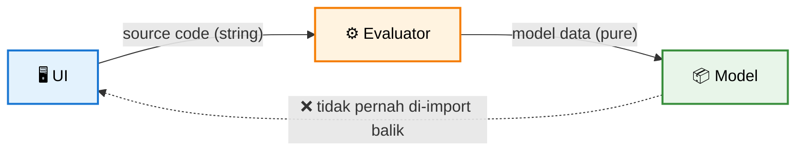

# Mini OpenSCAD

> Miniature CAD tool di browser — tulis OpenSCAD, lihat hasil 3D secara real-time.

Editor OpenSCAD ringan yang berjalan 100% di browser. Tidak butuh install, tidak butuh GPU khusus, tidak butuh koneksi setelah first load. Cukup buka browser dan mulai model.

   

---

## ✨ Fitur

### Bahasa
- **Primitives 3D** — `cube`, `sphere`, `cylinder`, `polyhedron`
- **Primitives 2D** — `circle`, `square`, `polygon`
- **Transforms** — `translate`, `rotate`, `scale`, `mirror`, `resize`, `multmatrix`, `color`
- **Boolean (CSG)** — `union`, `difference`, `intersection`, `hull`, `minkowski`
- **Extrusions** — `linear_extrude`, `rotate_extrude`, `offset` (2D & 3D)
- **Control flow** — `for`, `if/else`, `module`, `function`, `children()`, `$children`
- **Expressions** — list comprehension `[for ... if ...]`, ternary, vector ops
- **Modifiers** — `*` (disable), `!` (show-only), `#`
- **Debug** — `echo`, `assert`
- **STL import** — `import("model.stl")` dengan drag & drop

### Tool
- **Editor** dengan syntax highlighting + line numbers + undo/redo
- **3D viewer** dengan OrbitControls + wireframe + grid toggle
- **Parameter UI** — slider, enum, color, bool otomatis dari `// @param`
- **Multi-tab project** — beberapa proyek terpisah
- **Share via URL** — satu klik, bagikan model + parameter
- **Screenshot PNG** & **Turntable GIF** (offscreen renderer, resolusi tinggi)
- **Export STL** untuk 3D printing
- **Cheat sheet** — `?` untuk referensi lengkap
- **Friendly errors** — "mungkin maksud Anda X" untuk typo

### Infrastruktur
- **Web Worker** — evaluasi di thread terpisah, UI tidak freeze
- **Vite bundling** — build cepat, HMR, dependencies lokal
- **IndexedDB** — file STL tersimpan antar sesi
- **localStorage** — kode & parameter ter-persist
- **Offline-ready** — setelah first load, jalan tanpa internet

---

## 🚀 Quick Start

### Prasyarat
- **Node.js** ≥ 18 ([download](https://nodejs.org))
- **npm** ≥ 9 (biasanya bundled dengan Node)

### Install

```bash
git clone <repo-url> mini-open-scad
cd mini-open-scad
npm install
```

## Development

```sh
npm run dev
```
Buka http://localhost:8080 (atau port yang ditampilkan Vite).

## Production build

```sh
npm run build
npm run preview   # test hasil build
```

Output ada di `dist/` — folder static yang bisa di-deploy ke mana saja:

- Netlify (drag & drop `dist/`)
- Vercel (vercel deploy `dist/`)
- GitHub Pages
- Nginx / Apache
- Cloudflare Pages


## 📖 Cara Pakai

### 1. Hellow world nya CAD (Cube dengan lubang)


```c
// Kubus berlubang
$fn = 64;

difference() {
    cube([30, 30, 20], center = true);
    cylinder(h = 40, r = 8, center = true);
}
```
> Tips: tekan `Ctrl+Enter` untuk render kapan saja.

### 2. Slider parameter 

```c
// @param size  {slider 10 60 30} Box size
// @param color {color #3b82f6}  Color

color(color)
    cube([size, size, size], center = true);
```
Slider muncul otomatis di panel kanan. Geser → model update real-time.

### 3. Vase dengan rotate_extrude

```c
$fn = 96;

rotate_extrude(angle = 360)
    polygon(points = [
        [ 0,  0], [20,  0], [22, 15], [15, 35],
        [18, 55], [12, 70], [ 9, 70], [13, 55],
        [10, 35], [17, 15], [15,  3], [ 0,  3]
    ]);
```
### 4. Rounded Cube dengan `offset`

```c 
$fn = 32;
offset(r = 3, $fn = 16)
    cube([20, 20, 20], center = true);
```

### Buka contoh lainnya

Dropdown Presets di topbar berisi 8 contoh siap pakai:

- Cube, Sphere, Cylinder
- Difference (kubus berlubang)
- Union (silinder gabung)
- Gear (module + for + difference)
- For loop (grid kubus)
- Rotate extrude (torus)
- Mirror + color


# 📋 Cheat Sheet — Markdown Editor

## ⌨️ Shortcut Keyboard

| Shortcut | Aksi |
|:---|:---|
| `Ctrl` + `Enter` | 🚀 Render sekarang |
| `Ctrl` + `S` | 💾 Save ke localStorage |
| `Ctrl` + `Z` | ↩️ Undo |
| `Ctrl` + `Y` | ↪️ Redo |
| `Ctrl` + `Shift` + `Z` | ↪️ Redo (alternatif) |
| `Tab` | ➡️ Indent 2 spasi |
| `?` | ❓ Toggle cheat sheet |
| `Esc` | ❌ Tutup modal |

---

## 🧊 Viewer 3D

| Interaksi | Aksi |
|:---|:---|
| 🖱️ **Drag kiri** | 🔄 Rotate |
| 🖱️ **Drag kanan** | ✋ Pan |
| 🖱️ **Scroll** | 🔍 Zoom |

---

> 💡 **Tips:** Tekan `?` kapan saja untuk membuka/menutup cheat sheet ini.

## 🏗️ Arsitektur
```cmd
mini-open-scad/
├── index.html              # entry HTML
├── package.json
├── vite.config.js
├── src/
│   ├── main.js             # wiring semua modul
│   ├── config.js           # konfigurasi + presets
│   ├── state.js            # global state
│   ├── utils.js            # SCADError, helpers
│   ├── utils/suggest.js    # Levenshtein untuk friendly errors
│   ├── core/               # parsing bahasa
│   │   ├── tokenizer.js
│   │   ├── parser.js
│   │   ├── scope.js
│   │   ├── params.js       # parse @param annotations
│   │   └── ast-utils.js    # extract import("...")
│   ├── evaluator/          # eksekusi AST → geometry
│   │   ├── index.js        # evalExpr, evalStatements
│   │   ├── builtins.js     # module 3D/2D/transform/CSG
│   │   ├── functions.js    # fungsi matematika
│   │   ├── geometry.js     # Three.js helpers
│   │   ├── params.js       # applyParams (override AST)
│   │   └── csg.js          # three-bvh-csg setup
│   ├── viewer/             # 3D rendering
│   │   ├── scene.js        # Viewer class
│   │   └── model.js        # buildModel, serialize/deserialize
│   ├── worker/             # Web Worker
│   │   ├── eval-worker.js
│   │   └── worker-client.js
│   ├── files/              # STL file storage
│   │   └── file-store.js   # IndexedDB
│   ├── ui/                 # komponen UI
│   │   ├── editor.js
│   │   ├── console.js
│   │   ├── status.js
│   │   ├── params-panel.js
│   │   ├── tabbar.js
│   │   └── cheatsheet.js
│   ├── tabs.js             # TabManager
│   ├── share.js            # encode/decode share URL
│   ├── gif.js              # GIF encoder wrapper
│   └── styles.css
└── dist/                   # hasil build
```

# 🏗️ Design Principles

> Arsitektur inti dari engine ini dibangun di atas prinsip-prinsip berikut untuk menjaga **testability**, **maintainability**, dan **resilience**.

---

## ⚡ Pure Functions untuk Logika Inti

`tokenize()`, `parse()`, dan `buildModel()` adalah **pure functions** — tanpa side effect, tanpa dependensi ke DOM.

- ✅ **Mudah di-test** — input deterministik → output deterministik
- ✅ **Tanpa mocking DOM** — bisa jalan di Node.js
- ✅ **Composable** — output satu fungsi = input fungsi berikutnya

---

## 🎭 UI Tidak Tahu Tentang Bahasa

Layer **evaluator** tidak meng-`import` UI module — ketergantungan hanya satu arah.



- UI mengirim **source code** sebagai string
- Evaluator mengembalikan **model data** murni
- UI me-render hasilnya — tanpa perlu tahu sintaks bahasanya

---

## 🧵 Worker Boundary

Komunikasi ke **Web Worker** dijaga ketat via **transferable objects**.

| Aspek | Implementasi |
|:---|:---|
| 🔢 Format data | `Float32Array` (geometry buffer) |
| 🚚 Transfer | `postMessage(buf, [buf.buffer])` — zero-copy |
| 🚫 Shared state | **Tidak ada** — worker stateless per task |

> 💡 Worker hanya menerima input ter-serialisasi dan mengembalikan output ter-serialisasi. Tidak ada objek yang di-share antar thread.

---

## 🧩 Data-Driven UI

Form control **di-generate dinamis** dari metadata di dalam kode.

```js
// @param radius number  default=10  min=1  max=100
// @param height number  default=20  min=1  max=200
```

- 📝 Parser membaca komentar `// @param`
- 🎛️ Form di-render otomatis — tanpa hardcode per parameter
- ➕ Menambah parameter = cukup tambah komentar, **tanpa sentuh UI**

---

## 🛟 Graceful Degradation

Kegagalan tidak boleh membuat aplikasi crash — selalu ada jalur fallback.

| Kegagalan | Perilaku Sistem |
|:---|:---|
| ⚠️ **CSG gagal** | Warning ditampilkan → render **parsial** (shape yang valid tetap muncul) |
| 🔄 **Worker gagal** | Fallback ke eksekusi **sync** di main thread |

> Prinsip: **partial success > total failure**. User tetap mendapat hasil meski ada komponen yang gagal.

# 🧪 Testing

> Belum ada **automated test suite**, tapi tersedia **sanity checklist** manual per fitur untuk memastikan tiap komponen berfungsi sesuai harapan.

---

## 🌐 Bahasa

Setiap skenario berikut harus menghasilkan render yang **valid dan sesuai ekspektasi**.

| # | Fitur | Contoh Kode |
|:---:|:---|:---|
| **1** | 🧩 **CSG** | `difference() { cube(20); sphere(14); }` |
| **2** | 🔄 **Transform** | `translate([20, 0, 0]) rotate([0, 0, 45]) cube(10);` |
| **3** | 🔁 **Control Flow** | `for (i = [0 : 4]) translate([i * 12, 0, 0]) cube(10);` |
| **4** | 📐 **Function** | `function f(x) = x * 2;`<br>`cube(f(10));` |
| **5** | 📦 **Module + Children** | `module wrapper() { children(); }`<br>`wrapper() sphere(5);` |
| **6** | 🎚️ **Parameter** | `// @param s {slider 10 50 25} Size`<br>`cube(s);` |

---

## 🛠️ Tool

Checklist fitur aplikasi — semua harus **lulus tanpa error**.

| Fitur | Kriteria Lulus |
|:---|:---|
| 🔗 **Share URL** | Buka di tab baru → konten sama persis |
| 🖼️ **PNG / GIF Export** | File ter-download & **valid** (bisa dibuka) |
| 📂 **STL Import** | Model dari disk **tampil** di viewer |
| 🗂️ **Multi-tab** | Switch antar tab, **rename**, dan **close** berfungsi |
| ↩️ **Undo / Redo** | `Ctrl` + `Z` / `Ctrl` + `Y` bekerja konsisten |
| ❓ **Cheat Sheet** | Tekan `?` → modal **toggle** buka/tutup |

---

> 💡 **Catatan:** Checklist ini menjadi baseline sebelum automated test suite dibangun. Setiap fitur baru wajib menambah item ke sanity checklist terlebih dahulu.

# 🌐 Deploy

> Beberapa opsi deployment — pilih sesuai kebutuhan. **Netlify** paling cepat untuk prototyping, **Docker** untuk self-hosted.

---

## 🚀 Netlify — *Paling Cepat*

### Opsi 1: Drag & Drop

```bash
npm run build
# drag & drop folder dist/ ke https://app.netlify.com/drop
```

### Opsi 2: Via CLI

```bash
npm install -g netlify-cli
netlify deploy --prod --dir=dist
```

---

## ▲ Vercel

```bash
npm install -g vercel
vercel --prod
```

---

## 🐙 GitHub Pages

```bash
# di vite.config.js, tambahkan: base: '/<repo-name>/'
npm run build
# commit dist/ ke branch gh-pages
```

> ⚠️ **Penting:** Jangan lupa set `base: '/<repo-name>/'` di `vite.config.js`, jika tidak aset akan 404.

---

## 🐳 Docker *(Opsional)*

Cocok untuk **self-hosted** atau deployment on-premise.

### `Dockerfile`

```dockerfile
FROM node:20-alpine AS build
WORKDIR /app
COPY package*.json ./
RUN npm ci
COPY . .
RUN npm run build

FROM nginx:alpine
COPY --from=build /app/dist /usr/share/nginx/html
EXPOSE 80
```

### Build & Run

```bash
docker build -t mini-open-scad .
docker run -p 8080:80 mini-open-scad
```

Akses di **`http://localhost:8080`** 🎉

---

## 📊 Perbandingan

| Platform | Setup | Biaya | Cocok Untuk |
|:---|:---:|:---:|:---|
| 🚀 **Netlify** | ⚡ Sangat mudah | Gratis | Prototyping cepat |
| ▲ **Vercel** | ⚡ Mudah | Gratis | Preview per-PR |
| 🐙 **GitHub Pages** | 🔧 Manual | Gratis | Repo open-source |
| 🐳 **Docker** | 🔨 Menengah | Self-hosted | Kontrol penuh |

---

> 💡 **Tips:** Untuk demo publik, gunakan **Netlify Drop** — cukup drag `dist/` dan langsung online dalam hitungan detik, tanpa CLI atau akun kompleks.


# 🛠️ Development Tips

> Kumpulan tips praktis untuk **debugging** dan **extending** engine saat development.

---

## 🐞 Debug Worker

Worker berjalan di thread terpisah — gunakan **Chrome DevTools** untuk inspect.

```
Chrome DevTools
  └─ Sources
      └─ Sidebar → Workers
          └─ Klik eval-worker.js
              ├─ Set breakpoint
              └─ console.log() berjalan normal
```

> 💡 Worker punya **console sendiri** — `console.log` di dalamnya tetap muncul di tab Console utama.

---

## 📝 Enable Verbose Logs

Semua log di-prefix agar mudah difilter:

| Prefix | Sumber |
|:---|:---|
| `[worker]` | Worker utama |
| `[eval-worker]` | Evaluator worker |
| `[csg]` | CSG operations |
| `[share]` | Share URL module |
| `[gif]` | GIF export |

### Filter di Console

```
-[vite]
```

> 🎯 Exclude noise HMR dari Vite agar log aplikasi lebih bersih dan fokus.

---

## 🧩 Modify Builtins

Menambah module baru (misal `cylinder`, `cone`, `torus`):

### Langkah

1. **Buka** `src/evaluator/builtins.js`
2. **Cari** function `makeBuiltins(evalStatements)`
3. **Tambah** entry baru ke object yang di-return:

```js
function makeBuiltins(evalStatements) {
  return {
    cube, sphere,
    // ✨ tambahkan di sini
    cylinder: (r, h) => makeCylinder(r, h),
  };
}
```

4. **Selesai** — module langsung tersedia di bahasa ✅

---

## ✍️ Modify Syntax

Menambah **keyword highlighting** untuk sintaks baru:

### Langkah

1. **Buka** `src/ui/editor.js`
2. **Cari** `HL_KEYWORDS` Set
3. **Tambah** keyword:

```js
const HL_KEYWORDS = new Set([
  'module', 'function', 'for', 'if',
  // ✨ tambahkan di sini
  'intersection', 'hull', 'minkowski',
]);
```

> ⚠️ Highlighting **hanya visual** — untuk mendukung sintaks sebenarnya, perlu update di `src/evaluator/` juga.

---

## 📌 Quick Reference

| Task | File | Entry Point |
|:---|:---|:---|
| 🔍 Debug worker | DevTools | `Sources → Workers` |
| 🧩 Tambah module | `src/evaluator/builtins.js` | `makeBuiltins()` |
| ✍️ Tambah highlight | `src/ui/editor.js` | `HL_KEYWORDS` Set |
| 🎯 Filter log | Console | `-[vite]` |

---

> 💡 **Pro tip:** Sebelum menambah builtin baru, cek dulu implementasi `cube`/`sphere` sebagai pola — biasanya cukup mengikuti pola yang sama (terima params → return geometry buffer).

# 🐛 Known Issues

> Daftar isu yang sudah diketahui beserta **workaround** yang bisa dipakai saat ini.

---

## ⚠️ Issue & Workaround

### 🐌 `minkowski` lambat untuk mesh > 5000 vertex

Operasi Minkowski sangat mahal secara komputasi pada mesh besar.

> ✅ **Workaround:** Turunkan `$fn` atau pakai `offset(r)`

```openscad
// ❌ lambat
minkowski() { complex_mesh(); sphere(2, $fn=64); }

// ✅ lebih cepat
minkowski() { complex_mesh(); sphere(2, $fn=16); }
```

---

### 🧊 `offset(r<0)` (shrink) tidak didukung di 3D

Offset negatif hanya bekerja di 2D, belum diimplementasikan untuk 3D.

> ✅ **Workaround:** Pakai `difference()` dengan objek lebih besar

```openscad
// ❌ tidak didukung
offset(r = -2) cube(20);

// ✅ alternatif
difference() {
  cube(20);
  cube([24, 24, 24], center = true);
}
```

---

### ⏱️ Model kompleks + worker cold start = delay ~200ms

Worker perlu waktu inisialisasi pada render pertama.

> ✅ **Status:** **Normal** — delay hilang setelah warmup render pertama. Tidak perlu tindakan.

---

### 📱 GIF 60 frame di mobile bisa lag

Encoding GIF berat untuk device mobile, terutama pada frame count tinggi.

> ✅ **Workaround:** Pakai quality **"Small"**

| Setting | Frame | Ukuran | Mobile-friendly |
|:---|:---:|:---:|:---:|
| Default | 60 | Besar | ❌ |
| **Small** | 30 | Kecil | ✅ |

---

### 📦 STL sangat besar (>50MB) = slow parse

Parsing STL besar memblokir UI dan memakan memori.

> ✅ **Workaround:** Split file, atau **hindari di mobile**

- ✂️ Pecah STL menjadi bagian lebih kecil
- 📵 Jangan load file >50MB di mobile
- 💻 Desktop lebih toleran, tapi tetap lambat

---

## 📋 Ringkasan

| Issue | Severity | Workaround |
|:---|:---:|:---|
| `minkowski` lambat | 🟠 Sedang | Turunkan `$fn` / `offset(r)` |
| `offset(r<0)` 3D | 🟡 Rendah | `difference()` |
| Worker cold start | 🟢 Normal | Tunggu warmup |
| GIF lag di mobile | 🟠 Sedang | Quality "Small" |
| STL >50MB | 🔴 Tinggi | Split file / desktop only |

---

> 💡 **Catatan:** Isu dengan severity 🔴 sebaiknya dihindari di mobile. Untuk pengalaman terbaik, gunakan **desktop** saat bekerja dengan model kompleks atau file STL besar.

# 🤝 Kontribusi

> **PR welcome!** Untuk perubahan besar, buka **issue** terlebih dahulu untuk diskusi — hindari PR besar yang tidak dibahas sebelumnya.

---

## 📐 Style Guide

### 🔹 ES Modules

Gunakan `import` / `export` — konsisten di seluruh codebase.

```js
import { tokenize } from './parser.js';
export function parse(tokens) { /* ... */ }
```

### 🔹 No TypeScript *(saat ini)*

Proyek ini **belum** menggunakan TypeScript. Gunakan **JSDoc** untuk type hints.

```js
/**
 * @param {string} source
 * @returns {Token[]}
 */
function tokenize(source) { /* ... */ }
```

### 🔹 Prefix Console Log

Setiap log wajib diberi prefix **nama module** dalam kurung siku.

```js
console.log('[worker] starting...');
console.warn('[csg] fallback triggered');
console.error('[eval-worker] parse failed', err);
```

> 🎯 Memudahkan filter di DevTools: `[worker]`, `[csg]`, `[share]`, dll.

### 🔹 Komentar Bahasa Indonesia

Untuk logika yang **tidak obvious**, tulis komentar dalam **Bahasa Indonesia**.

```js
// Normalisasi vektor agar konsisten terhadap winding order
// — kalau dibalik, CSG bisa menghasilkan mesh inverted
const normal = cross(b.sub(a), c.sub(a)).normalize();
```

---

## ✅ Sebelum Commit

Selalu jalankan build untuk memastikan tidak ada error bundling:

```bash
npm run build   # pastikan tidak ada error bundling
```

> ⚠️ **Jangan commit** jika build gagal — termasuk warning yang mengindikasikan masalah bundling.

---

## 📋 Checklist Kontribusi

| ✅ | Item |
|:---:|:---|
| ☐ | Issue dibuka dulu (untuk perubahan besar) |
| ☐ | ES modules — tidak ada `require()` |
| ☐ | JSDoc untuk fungsi publik baru |
| ☐ | Console log berprefix `[module]` |
| ☐ | Komentar Bahasa Indonesia untuk logika rumit |
| ☐ | `npm run build` lulus tanpa error |

---

> 💡 **Tips:** PR kecil & fokus lebih mudah di-review daripada PR besar yang menyentuh banyak file sekaligus. Pecah perubahan menjadi bagian-bagian logis.


# 📄 Lisensi

**MIT** — lihat [`LICENSE`](./LICENSE) untuk detail.

> Bebas digunakan, dimodifikasi, dan didistribusikan — dengan tetap menyertakan atribusi.

---

# 🙏 Credits

Proyek ini berdiri di atas kerja keras komunitas open-source:

| Proyek | Peran |
|:---|:---|
| 🧩 **OpenSCAD** | Inspirasi bahasa & filosofi |
| 🎨 **Three.js** | Rendering 3D |
| 🔧 **three-bvh-csg** | CSG engine |
| 🎞️ **gifenc** | GIF encoding |
| ⚡ **Vite** | Build tool |

---

# 📞 Support

| Kebutuhan | Jalur |
|:---|:---|
| 🐛 **Bug report** | Buka **issue** |
| 💡 **Feature request** | Buka **discussion** |
| ❓ **Pertanyaan** | Mulai dari **`?`** di dalam app |

---

<div align="center">

### Made with ❤️ untuk komunitas maker Indonesia

> *"CAD di browser, tanpa install, tanpa ribet."*

</div>