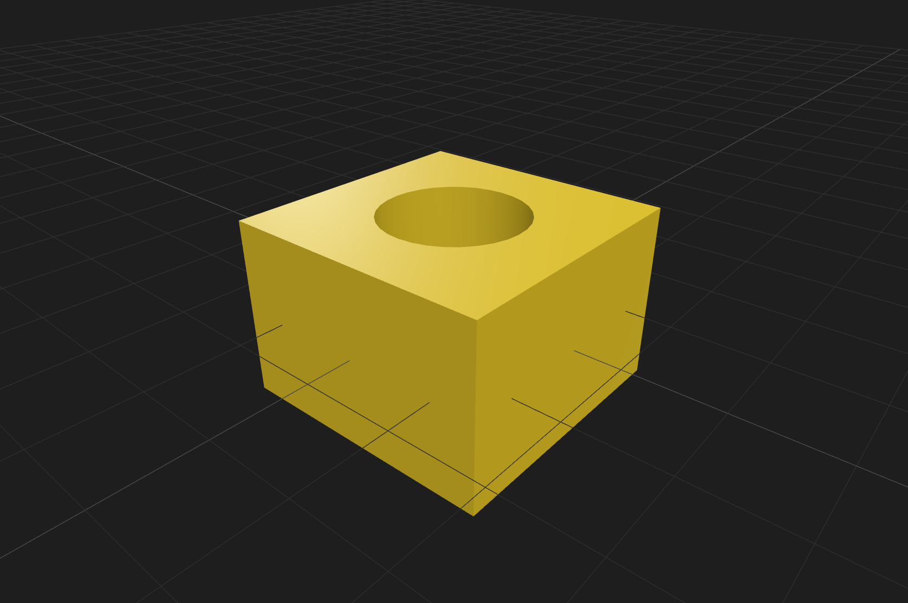
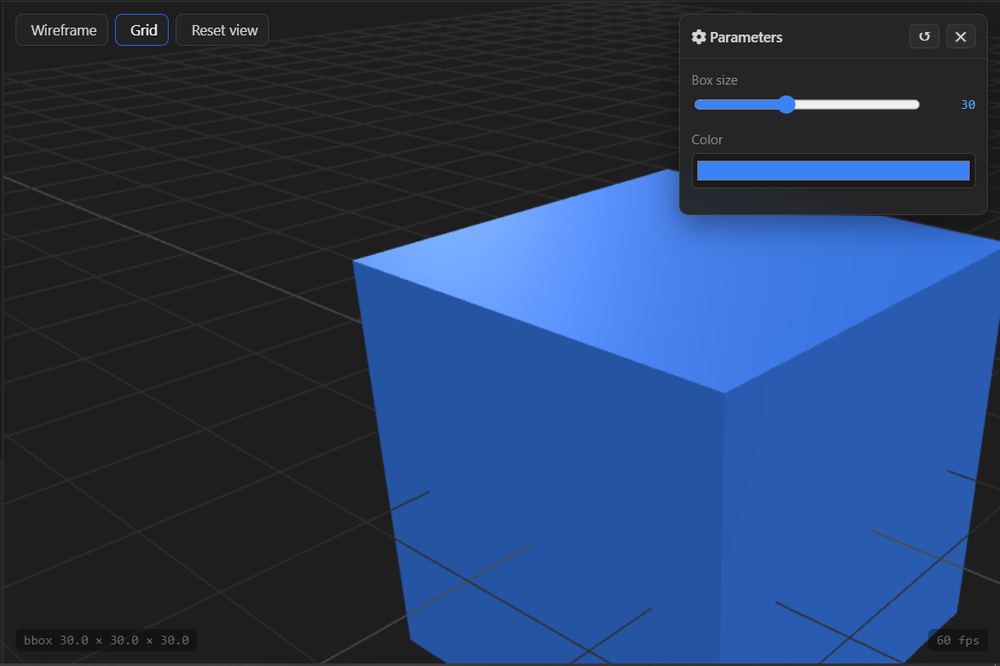
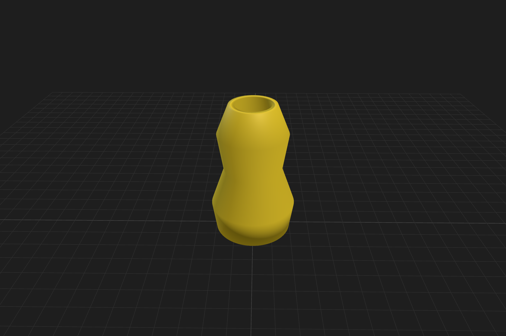
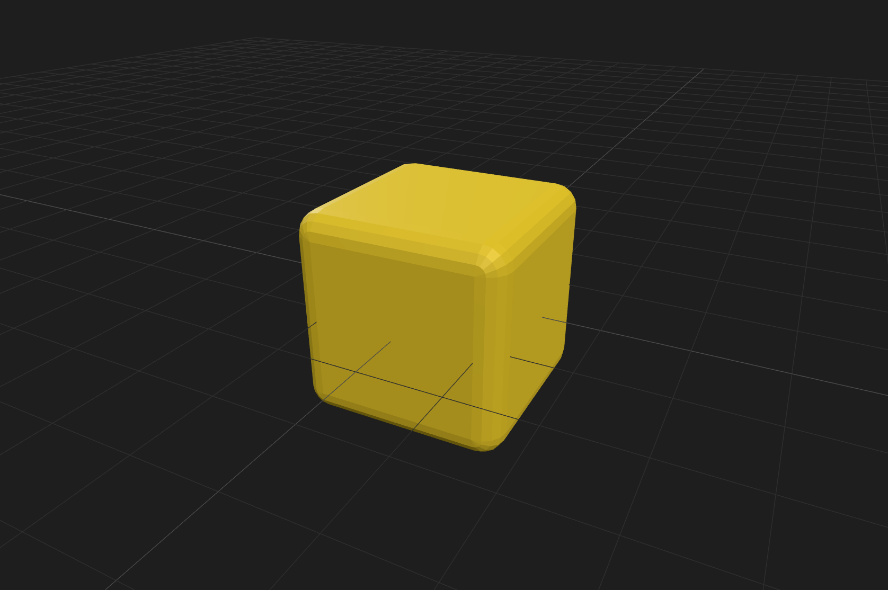


# Mini OpenSCAD

> Miniature CAD tool di browser — tulis OpenSCAD, lihat hasil 3D secara real-time.

Editor OpenSCAD ringan yang berjalan 100% di browser. Tidak butuh install, tidak butuh GPU khusus, tidak butuh koneksi setelah first load. Cukup buka browser dan mulai model.

     

---

## 📚 Documentation

| Dokumen                                                                | Deskripsi                                                 |
| :--------------------------------------------------------------------- | :-------------------------------------------------------- |
| [🏗️ Arsitektur & Design Principles](./docs-md/architecture.md)         | Struktur proyek, 9 prinsip desain, roadmap fase 0-5       |
| [🛡️ Rencana Arsitektur Robust](./docs-md/rencana-arsitektur-robust.md) | Audit, kontrak, state store, worker persistent            |
| [🆕 Fitur Terbaru](./docs-md/fitur-terbaru.md)                         | Daftar fitur-fitur terbaru yang sudah terimplementasi     |
| [🐛 Troubleshooting & CSG](./docs-md/troubleshooting.md)               | Catatan sejarah perbaikan engine (Manifold, STL, 3MF)     |
| [🧪 Testing & Sanity Checklist](./docs-md/testing.md)                  | Checklist manual fitur bahasa & tool                      |
| [📊 Benchmark & Stress Test](./docs-md/benchmark.md)                   | Hasil uji beban (Stress Test), bug hunting, dan edge case |
| [🌐 Deploy Guide](./docs-md/deploy.md)                                 | Netlify, Vercel, GitHub Pages, Docker                     |
| [🛠️ Development Tips](./docs-md/dev-tips.md)                           | Debug Worker, verbose logs, extend builtins & syntax      |
| [🐛 Known Issues](./docs-md/known-issues.md)                           | Isu yang diketahui beserta workaround                     |
| [🤝 Kontribusi](./docs-md/contributing.md)                             | Style guide, checklist PR, cara berkontribusi             |

---

## ✨ Fitur

### 🧩 Bahasa OpenSCAD

- **Primitives 3D** — `cube`, `sphere`, `cylinder`, `polyhedron`
- **Primitives 2D** — `circle`, `square`, `polygon`, `text` (Latin + Jepang)
- **Transforms** — `translate`, `rotate`, `scale`, `mirror`, `resize`, `multmatrix`, `color`
- **Boolean (CSG)** — `union`, `difference`, `intersection`, `hull`, `minkowski`
- **Extrusions** — `linear_extrude` (dengan `twist` & `scale`), `rotate_extrude`, `offset` (2D & 3D)
- **Control Flow** — `for`, `intersection_for`, `if/else`, `module`, `function`, `children()`, `$children`
- **Advanced** — List comprehension (`[for ... each ... if ...]`), anonymous function (`f = function(x) x*2`), `let()`, ternary
- **Modifiers** — `*` (disable), `!` (show-only), `#` (highlight), `%` (background)
- **Math & Data** — 40+ builtin: `sin`, `cos`, `min`, `max`, `norm`, `cross`, `rands`, `chr`, `ord`, `search`, `is_num`, `is_list`, `is_string`, dll
- **Debug** — `echo`, `assert`
- **STL Import** — `import("model.stl")` dengan drag & drop

### 🎨 Editor & UI

- **Editor Pro** — Syntax highlighting, line numbers, undo/redo, **Code Folding**, **Auto-format (`Shift+Alt+F`)**, **Toggle Line Comment (`Ctrl+/`)**, **Multi-cursor (`Ctrl+Alt+↓`)**
- **Parameter UI** — Slider, enum, color, bool otomatis dari `// @param` atau OpenSCAD Customizer
- **Multi-tab Project** — Beberapa proyek terpisah dengan rename dan close
- **Find & Replace** — `Ctrl+F` / `Ctrl+H` dengan case-sensitive & whole-word
- **Cheat Sheet** — `?` untuk referensi lengkap bahasa + shortcut
- **Friendly Errors** — "Mungkin maksud Anda X" untuk typo variabel/fungsi

### 🖥️ Viewer 3D

- **OrbitControls** — Drag kiri (rotate), drag kanan (pan), scroll (zoom)
- **Camera Presets** — 7 view: ISO, FRT, RGT, TOP, BCK, LFT, BTM (dengan keyboard `1`-`7`)
- **Fullscreen Mode** — `F` untuk fokus penuh
- **Studio Lighting** — Preset Default / Studio (PBR + Soft Shadows) / Dramatic
- **Section Plane** — Potong model di sumbu X/Y/Z (lihat isi dalam)
- **Dimension Overlay** — BBox wireframe + dimensi X/Y/Z otomatis
- **Measure Tool** — Ukur jarak 2 titik dengan **Vertex/Edge/Face Snapping** (CAD-grade)
- **Printability Checker** — Highlight area overhang > 45° (merah = butuh support)
- **Wireframe & Grid** — Toggle visual

### 📤 Export & Capture

- **STL** (binary, watertight) · **3MF** (modern, dengan weld) · **OBJ** · **GLB/glTF** (PBR) · **PLY** (vertex colors)
- **SVG & DXF** — Export 2D untuk Laser Cutting/CNC
- **PDF Blueprint** — Technical drawing A4: 7 views + title block
- **Screenshot PNG** — Offscreen render 2× resolusi
- **Turntable GIF** — Rotasi 360° otomatis (3 preset quality)
- **Param Animation GIF** — Animasikan slider parameter (ping-pong) ke GIF
- **Save/Load Project .zip** — Bawa kode + file STL dalam satu file

### 🔗 Sharing & Persistence

- **Share via URL** — Gzip-compressed, versioned (tolak versi mismatch)
- **Multi-tab** — Simpan proyek di localStorage (auto-migrate v1 → v3)
- **File Store** — IndexedDB untuk STL antar sesi
- **Light/Dark Theme** — Toggle dengan persistensi
- **Offline-ready** — Setelah first load, jalan tanpa internet

---

## 🏗️ Infrastruktur Arsitektur

Hasil refactor **Fase 0-5** (lihat [rencana-arsitektur-robust.md](./docs-md/rencana-arsitektur-robust.md)):

| Fitur                     | Deskripsi                                                                  |
| :------------------------ | :------------------------------------------------------------------------- |
| **Web Worker Persistent** | Worker dibuat **sekali** (bukan per render), hemat ~200-500ms              |
| **AST Cache**             | Parse ulang hanya saat kode berubah — slider drag nyaris instan            |
| **Frozen State Store**    | `store.getState()` mengembalikan snapshot immutable + `dispatch/subscribe` |
| **Error Boundary**        | Async error tertangkap → toast + log (tidak ada layar putih)               |
| **Contract Versioning**   | Storage/Share/Worker punya `schemaVersion` eksplisit + auto-backup         |
| **Manifold WASM**         | Engine CSG WebAssembly — 100% watertight, siap 3D printing                 |
| **Cancellation**          | Cancel render kooperatif tanpa membuang WASM state                         |
| **CI/CD**                 | GitHub Actions otomatis build + 21 unit tests                              |
| **Public API**            | `src/api.js` sebagai entry point stabil untuk test/integrasi               |

---

## 🚀 Quick Start

### Prasyarat

- **Node.js** ≥ 18
- **npm** ≥ 9

### Install

```bash
git clone <repo-url> mini-open-scad
cd mini-open-scad
npm install
```


### Development

```sh
npm run dev
```

Buka http://localhost:8080 (atau port yang ditampilkan Vite).

### Build & Test

```sh
npm run build     # production build
npm test          # run 21 unit tests
npm run preview   # test hasil build
```

Output ada di `dist/` — folder static yang bisa di-deploy ke mana saja. Lihat [Deploy Guide](./docs-md/deploy.md) untuk detail.

---

## 📖 Cara Pakai

### 1. Hello world CAD (Cube dengan lubang)



```c
$fn = 64;

difference() {
    cube([30, 30, 20], center = true);
    cylinder(h = 40, r = 8, center = true);
}
```

> Tips: tekan `Ctrl+Enter` untuk render kapan saja.

### 2. Slider parameter



```c
// @param size  {slider 10 60 30} Box size
// @param color {color #3b82f6}  Color

color(color)
    cube([size, size, size], center = true);
```

### 3. Vase dengan rotate_extrude



```c
$fn = 96;
rotate_extrude(angle = 360)
    polygon(points = [
        [ 0,  0], [20,  0], [22, 15], [15, 35],
        [18, 55], [12, 70], [ 9, 70], [13, 55],
        [10, 35], [17, 15], [15,  3], [ 0,  3]
    ]);
```

### 4. Rounded Cube dengan `offset`



```c
$fn = 32;
offset(r = 3, $fn = 16)
    cube([20, 20, 20], center = true);
```

### Presets bawaan

Dropdown **Presets** di topbar berisi 8 contoh siap pakai: Cube, Sphere, Cylinder, Difference, Union, Gear, For loop, Rotate extrude, Mirror + color.

---

## ⌨️ Shortcut Keyboard

### Global

| Shortcut                    | Aksi                                            |
| :-------------------------- | :---------------------------------------------- |
| `Ctrl` + `Enter`            | 🚀 Render                                       |
| `Ctrl` + `S`                | 💾 Save                                         |
| `Ctrl` + `Z` / `Ctrl` + `Y` | ↩️ Undo / Redo                                  |
| `Ctrl` + `F` / `Ctrl` + `H` | 🔍 Find / Replace                               |
| `Ctrl` + `G`                | ➡️ Go to line                                   |
| `Ctrl` + `/`                | 💬 Toggle line comment                          |
| `Shift` + `Alt` + `F`       | ✨ Format code                                  |
| `?`                         | ❓ Toggle cheat sheet                           |
| `F5` / `F6`                 | 👁 Preview / ✦ Render mode                      |
| `F`                         | ⛶ Fullscreen viewport                           |
| `M`                         | 📐 Measure tool                                 |
| `Esc`                       | ❌ Tutup modal / Cancel render                  |
| `1` - `7`                   | 📷 Camera presets (ISO/FRT/RGT/TOP/BCK/LFT/BTM) |

### Editor

| Shortcut                   | Aksi                       |
| :------------------------- | :------------------------- |
| `Ctrl` + `Alt` + `↓` / `↑` | Multi-cursor below / above |
| `Ctrl` + Klik              | Add cursor                 |
| `Tab`                      | Indent 2 spasi             |

### Viewer 3D

| Interaksi         | Aksi      |
| :---------------- | :-------- |
| 🖱️ **Drag kiri**  | 🔄 Rotate |
| 🖱️ **Drag kanan** | ✋ Pan    |
| 🖱️ **Scroll**     | 🔍 Zoom   |

---

## 🧪 Testing

```bash
npm test
```

**21 unit tests** mencakup:

- `tokenizer.test.js` (4) — Tokenizer dasar, komentar, modifier, notasi ilmiah
- `model.test.js` (8) — Golden test 8 preset (tokenize → parse → eval → geometry)
- `app-store.test.js` (5) — Frozen snapshot, dispatch, subscribe
- `api.test.js` (2) — Public API stability
- `docs-sync.test.js` (2) — Docs sync + no test imports in prod

CI (GitHub Actions) menjalankan `npm run build` + `npm test` otomatis pada setiap push/PR.

---

## 📄 Lisensi

**MIT** — lihat [`LICENSE`](./LICENSE) untuk detail.

---

## 🙏 Credits

| Proyek               | Peran                                  |
| :------------------- | :------------------------------------- |
| 🧩 **OpenSCAD**      | Inspirasi bahasa & filosofi            |
| 🎨 **Three.js**      | Rendering 3D                           |
| 🧊 **Manifold-3D**   | CSG Engine WASM (watertight)           |
| 🔧 **three-bvh-csg** | CSG fallback                           |
| 🎞️ **gifenc**        | GIF encoding                           |
| 🗜️ **fflate**        | ZIP compression (3MF & project backup) |
| 📄 **jsPDF**         | PDF Blueprint generation               |
| 🧪 **Vitest**        | Unit test runner                       |
| ⚡ **Vite**          | Build tool                             |

---

## 📞 Support

| Kebutuhan              | Jalur                      |
| :--------------------- | :------------------------- |
| 🐛 **Bug report**      | Buka **issue**             |
| 💡 **Feature request** | Buka **discussion**        |
| ❓ **Pertanyaan**      | Tekan **`?`** di dalam app |

---

<div align="center">

### Made with ❤️ untuk komunitas maker Indonesia

> _"CAD di browser, tanpa install, tanpa ribet."_

</div>

---
