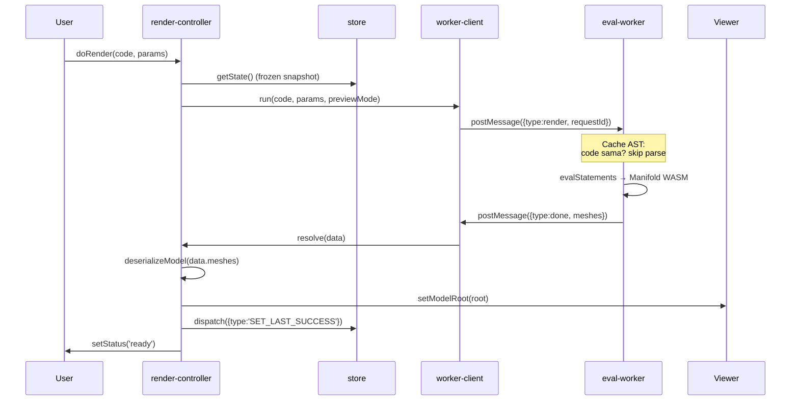


# 🏗️ Arsitektur & Design Principles

> ← Kembali ke [README utama](../README.md) · Lihat juga [rencana-arsitektur-robust.md](./rencana-arsitektur-robust.md) (audit & roadmap)

---

## 📁 Struktur Proyek
```

mini-open-scad/
├── index.html # entry HTML
├── .github/workflows/ci.yml # GitHub Actions CI (build + test)
├── public/
│ └── manifold.wasm # WebAssembly biner untuk engine CSG
├── src/
│ ├── main.js # Composition Root (~9 KB) — hanya wiring
│ ├── api.js # Public API stabil (untuk test/integrasi)
│ ├── config.js # CONFIG + TIME_BUDGET + PRESETS
│ ├── state.js # Facade @deprecated → store/app-store.js
│ ├── utils.js # SCADError, helpers
│ ├── format.js # Auto-formatter OpenSCAD
│ ├── share.js # encode/decode share URL (versioned)
│ ├── gif.js # GIF encoder wrapper
│ ├── profiler.js # Performance profiler (+ exportReport)
│ ├── tabs.js # TabManager
│ │
│ ├── contract/ # ✨ [Fase 1] Skema & versi
│ │ └── schemas.js # STORAGE/SHARE/WORKER schemaVersion
│ │
│ ├── store/ # ✨ [Fase 2] State management
│ │ ├── app-store.js # Frozen snapshot + dispatch/subscribe
│ │ └── app-store.test.js # Unit test (5)
│ │
│ ├── core/ # parsing bahasa
│ │ ├── tokenizer.js
│ │ ├── tokenizer.test.js # Unit test (4)
│ │ ├── parser.js
│ │ ├── scope.js
│ │ ├── params.js # parse @param annotations
│ │ └── ast-utils.js # extract import("...")
│ │
│ ├── evaluator/ # eksekusi AST → geometry
│ │ ├── index.js # evalExpr, evalStatements (dengan hoisting)
│ │ ├── builtins.js # module 3D/2D/transform/CSG
│ │ ├── functions.js # fungsi matematika & data
│ │ ├── geometry.js # Three.js helpers
│ │ ├── manifold-engine.js # WebAssembly Manifold-3d
│ │ ├── mesh-utils.js # Geometry cleaning
│ │ ├── params.js # applyParams (override AST)
│ │ └── csg.js # three-bvh-csg (fallback only)
│ │
│ ├── viewer/ # 3D rendering
│ │ ├── scene.js # Viewer class, camera, lights, measure
│ │ ├── model.js # buildModel (+AST cache), serialisasi
│ │ └── model.test.js # Golden test 8 preset
│ │
│ ├── worker/ # Web Worker (persistent)
│ │ ├── eval-worker.js # Init sekali, loop render berulang
│ │ └── worker-client.js # requestId protocol + watchdog
│ │
│ ├── files/ # STL file storage
│ │ └── file-store.js # IndexedDB (+QuotaExceeded handler)
│ │
│ ├── ui/ # komponen UI murni
│ │ ├── editor.js
│ │ ├── console.js
│ │ ├── status.js
│ │ ├── params-panel.js
│ │ ├── tabbar.js
│ │ ├── cheatsheet.js
│ │ ├── dropdown.js
│ │ ├── home.js
│ │ ├── find-replace.js
│ │ └── profiler-panel.js
│ │
│ ├── app/ # ✨ [Fase 2] Composition modules
│ │ ├── error-boundary.js # Global error handler (safety net)
│ │ ├── render-controller.js # doRender, scheduleSave, doFormat
│ │ ├── files-ui.js # STL import & file manager
│ │ ├── share-ui.js # Share modal
│ │ ├── home-ui.js # Home screen & ZIP loader
│ │ ├── toolbar.js # Tombol topbar & preset dropdown
│ │ ├── editor-setup.js # Setup editor & find-replace
│ │ ├── preview-setup.js # Preview mode toggle
│ │ ├── tabs-setup.js # Tab manager wiring
│ │ ├── boot.js # Boot app (share URL + home screen)
│ │ ├── shortcuts.js # Keyboard shortcuts
│ │ ├── viewer-tools.js # Camera, section, measure, lighting
│ │ ├── capture.js # PNG, GIF, animation
│ │ └── export-ui.js # Export dropdown & PDF
│ │
│ ├── export.js # STL, 3MF, OBJ, GLB, glTF, PLY
│ ├── export-2d.js # SVG & DXF (2D vektor)
│ ├── export-pdf.js # PDF Blueprint (technical drawing)
│ ├── project-backup.js # Save/Load project .zip
│ └── styles.css
│
├── docs-md/ # Dokumentasi Markdown
├── docs-html/ # Dokumentasi HTML interaktif
└── dist/ # hasil build

````

---

## ⚡ Design Principles

> Arsitektur dibangun di atas **9 prinsip** untuk menjaga *testability*, *maintainability*, dan *resilience*. Prinsip 1-5 adalah fondasi awal; prinsip 6-9 adalah hasil dari audit dan refactor Fase 0-5.

---

### 1. Pure Functions untuk Logika Inti

`tokenize()`, `parse()`, dan `buildModel()` adalah **pure functions** — tanpa side effect, tanpa dependensi ke DOM.

- ✅ **Mudah di-test** — input deterministik → output deterministik
- ✅ **Tanpa mocking DOM** — bisa jalan di Node.js
- ✅ **Composable** — output satu fungsi = input fungsi berikutnya

---

### 2. UI Tidak Tahu Tentang Bahasa

Layer **evaluator** tidak meng-`import` UI module — ketergantungan hanya satu arah.

```mermaid
flowchart LR
    UI["🖥️ UI"]
    EVAL["⚙️ Evaluator"]
    MODEL["📦 Model"]

    UI -->|"source code (string)"| EVAL
    EVAL -->|"model data (pure)"| MODEL

    MODEL -.->|"❌ tidak pernah di-import balik"| UI

    style UI fill:#e3f2fd,stroke:#1976d2,stroke-width:2px,color:#000
    style EVAL fill:#fff3e0,stroke:#f57c00,stroke-width:2px,color:#000
    style MODEL fill:#e8f5e9,stroke:#388e3c,stroke-width:2px,color:#000
````

---

### 3. Worker Boundary (Persistent)

Sejak **Fase 3**, Worker adalah **persistent** (dibuat sekali, dipakai berulang), bukan per render.

| Aspek           | Implementasi                                           |
| :-------------- | :----------------------------------------------------- |
| 🔢 Format data  | `Float32Array` (geometry buffer)                       |
| 🚚 Transfer     | `postMessage(buf, [buf.buffer])` — zero-copy           |
| 🚫 Shared state | **Tidak ada** — worker stateless per request           |
| 🆔 Protokol     | `requestId` + `type: render/cancel/done/error`         |
| ⏱️ Watchdog     | Dihitung dari `TIME_BUDGET` di `config.js`             |
| ❌ Cancel       | Kooperatif — Worker cek `cancelFlag` di antara iterasi |

> 💡 Worker mengirim sinyal `{ type: 'ready' }` sekali setelah `initManifold()` + `preloadOpenTypeFonts()`. Setelah itu siap menerima render berulang tanpa re-init.

---

### 4. Data-Driven UI

Form control **di-generate dinamis** dari metadata di dalam kode.

```js
// @param radius {slider 1 100 10} Radius
// @param height {slider 1 200 20} Height
```

- 📝 Parser membaca komentar `// @param`
- 🎛️ Form di-render otomatis — tanpa hardcode per parameter
- ➕ Menambah parameter = cukup tambah komentar, **tanpa sentuh UI**

---

### 5. Graceful Degradation

Kegagalan tidak boleh membuat aplikasi crash — selalu ada jalur fallback.

| Kegagalan                     | Perilaku Sistem                                                     |
| :---------------------------- | :------------------------------------------------------------------ |
| ⚠️ **CSG gagal**              | Warning ditampilkan → render **parsial** (shape valid tetap muncul) |
| 🔄 **Worker gagal**           | Fallback ke eksekusi **sync** di main thread                        |
| 💾 **Storage penuh**          | Toast actionable ("hapus project lama")                             |
| 🌐 **Share version mismatch** | Toast "link dari versi lebih baru"                                  |

> Prinsip: **partial success > total failure**. User tetap mendapat hasil meski ada komponen yang gagal.

---

### 6. Explicit Contract (Fase 1) ✨

Setiap lintas-batas (worker, storage, share, URL) punya **skema berversi** dan **validator** yang menolak input tak dikenal dengan pesan jelas.

```js
// src/contract/schemas.js
export const WORKER_PROTOCOL_VERSION = 2;
export const STORAGE_SCHEMA_VERSION = 3;
export const SHARE_SCHEMA_VERSION = 2;
```

**Manfaat:**

- 🛡️ User data tidak hilang diam-diam saat upgrade
- 🔒 Link share dari versi lebih baru ditolak dengan pesan ramah
- 🔍 Debug mudah — error menyebut "versi X tidak dikenal"

---

### 7. Single Source of Truth (Fase 2) ✨

Satu `store` untuk state aplikasi; satu `TIME_BUDGET` untuk semua angka waktu.

```js
// src/store/app-store.js — snapshot frozen
const snapshot = store.getState();
snapshot.autoRender = false; // ❌ TypeError: object is frozen

// Cara benar:
store.dispatch({ type: "SET_AUTO_RENDER", payload: false }); // ✅
```

```js
// src/config.js — angka waktu terpusat
export const TIME_BUDGET = {
  evalDefaultMs: 15000, // default $maxTime
  evalHardCapMs: 120000, // batas keras
  watchdogGraceMs: 5000, // toleransi tambahan
};
```

**Manfaat:**

- 🎯 Tidak ada bug "state berubah karena siapa" — semua via `dispatch`
- ⏱️ Tidak ada komentar "60s" yang menyesatkan (angka dihitung dari config)

---

### 8. Fail Loud at Build, Quiet at Runtime (Fase 5) ✨

Pelanggaran kontrak ditolak saat build/test; saat runtime, kegagalan selalu punya jalur fallback + log terstruktur.

| Lapisan      | Perilaku                                                                   |
| :----------- | :------------------------------------------------------------------------- |
| **Build/CI** | `npm run build` gagal jika import rusak; `npm test` gagal jika ada regresi |
| **Runtime**  | Error async ditangkap `error-boundary.js` → toast + log (tidak crash)      |
| **Contract** | Payload worker divalidasi; versi tak dikenal → error terklasifikasi        |

**Manfaat:**

- 🚨 Bug tertangkap sebelum user melihatnya
- 📊 Error punya `kind` yang bisa di-monitor

---

### 9. Composition Root yang Dapat Diuji (Fase 2) ✨

`main.js` hanya merangkai; setiap fitur didaftarkan lewat fungsi `register(ctx)` yang bisa dipanggil di lingkungan test tanpa DOM penuh.

```js
// src/main.js (~9 KB)
const renderController = initRenderController({ editor, viewer, ... });
const { editor, findReplace } = setupEditor({ ... });
initToolbar({ ... });
initShortcuts({ ... });
// ... hanya wiring, tanpa logika bisnis
```

**Manfaat:**

- 📦 `main.js` dari 23 KB → 9 KB (60% reduksi)
- 🧪 Modul bisa di-test terpisah
- 🔌 Fitur baru = tambah satu file `app/*.js` + satu baris `init*()`

---

## 🔄 Roadmap & Fase Arsitektur

Dokumen lengkap audit & roadmap ada di [rencana-arsitektur-robust.md](./rencana-arsitektur-robust.md).

| Fase | Fokus                     | Status | Highlight                           |
| :--: | :------------------------ | :----: | :---------------------------------- |
|  0   | Safety Net                |   ✅   | Error Boundary + Vitest + CI        |
|  1   | Kontrak & Versioning      |   ✅   | Storage/Share/Worker versioned      |
|  2   | State Store & Decouple    |   ✅   | app-store + 10 modul `app/*`        |
|  3   | Worker Persistent         |   ✅   | Worker dibuat sekali, -200ms/render |
|  4   | Performa & Resiliensi     |   ✅   | AST cache, debounce, quota handling |
|  5   | Observability & Docs Sync |   ✅   | `api.js`, render report, docs test  |

### Pencapaian Terukur

| Metrik                 |     Sebelum     |                      Sesudah                      |
| :--------------------- | :-------------: | :-----------------------------------------------: |
| `main.js`              |      23 KB      |                     **~9 KB**                     |
| Worker per render      |     1 baru      |                 **1 persistent**                  |
| Parse saat slider drag |   Setiap kali   |                   **Cache AST**                   |
| Test otomatis          |        0        | **21 tests** (tokenizer, model, store, api, docs) |
| CI                     |       ❌        |                 ✅ GitHub Actions                 |
| Error async            |   Hilang diam   |                **Error Boundary**                 |
| State mutation         |    Tersebar     |               **Frozen + dispatch**               |
| Storage schema         | Tidak versioned |               **v3 + auto-backup**                |

---

## 🧭 Alur Render Pipeline (Current)



---

> ← Kembali ke [README utama](../README.md) · [rencana-arsitektur-robust.md](./rencana-arsitektur-robust.md)


---
