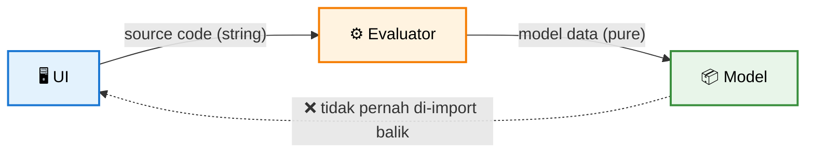

# 🏗️ Arsitektur & Design Principles

> ← Kembali ke [README utama](../README.md)

---

## 📁 Struktur Proyek

```
mini-open-scad/
├── index.html              # entry HTML
├── package.json
├── vite.config.js
├── src/
│   ├── main.js             # wiring semua modul
│   ├── config.js           # konfigurasi + presets
│   ├── state.js            # global state
│   ├── utils.js            # SCADError, helpers
│   ├── utils/suggest.js    # Levenshtein untuk friendly errors
│   ├── core/               # parsing bahasa
│   │   ├── tokenizer.js
│   │   ├── parser.js
│   │   ├── scope.js
│   │   ├── params.js       # parse @param annotations
│   │   └── ast-utils.js    # extract import("...")
│   ├── evaluator/          # eksekusi AST → geometry
│   │   ├── index.js        # evalExpr, evalStatements
│   │   ├── builtins.js     # module 3D/2D/transform/CSG
│   │   ├── functions.js    # fungsi matematika
│   │   ├── geometry.js     # Three.js helpers
│   │   ├── params.js       # applyParams (override AST)
│   │   └── csg.js          # three-bvh-csg setup
│   ├── viewer/             # 3D rendering
│   │   ├── scene.js        # Viewer class
│   │   └── model.js        # buildModel, serialize/deserialize
│   ├── worker/             # Web Worker
│   │   ├── eval-worker.js
│   │   └── worker-client.js
│   ├── files/              # STL file storage
│   │   └── file-store.js   # IndexedDB
│   ├── ui/                 # komponen UI
│   │   ├── editor.js
│   │   ├── console.js
│   │   ├── status.js
│   │   ├── params-panel.js
│   │   ├── tabbar.js
│   │   └── cheatsheet.js
│   ├── tabs.js             # TabManager
│   ├── share.js            # encode/decode share URL
│   ├── gif.js              # GIF encoder wrapper
│   └── styles.css
└── dist/                   # hasil build
```

---

## ⚡ Design Principles

> Arsitektur inti dibangun di atas prinsip-prinsip berikut untuk menjaga **testability**, **maintainability**, dan **resilience**.

---

### 1. Pure Functions untuk Logika Inti

`tokenize()`, `parse()`, dan `buildModel()` adalah **pure functions** — tanpa side effect, tanpa dependensi ke DOM.

- ✅ **Mudah di-test** — input deterministik → output deterministik
- ✅ **Tanpa mocking DOM** — bisa jalan di Node.js
- ✅ **Composable** — output satu fungsi = input fungsi berikutnya

---

### 2. UI Tidak Tahu Tentang Bahasa

Layer **evaluator** tidak meng-`import` UI module — ketergantungan hanya satu arah.



- UI mengirim **source code** sebagai string
- Evaluator mengembalikan **model data** murni
- UI me-render hasilnya — tanpa perlu tahu sintaks bahasanya

---

### 3. Worker Boundary

Komunikasi ke **Web Worker** dijaga ketat via **transferable objects**.

| Aspek | Implementasi |
|:---|:---|
| 🔢 Format data | `Float32Array` (geometry buffer) |
| 🚚 Transfer | `postMessage(buf, [buf.buffer])` — zero-copy |
| 🚫 Shared state | **Tidak ada** — worker stateless per task |

> 💡 Worker hanya menerima input ter-serialisasi dan mengembalikan output ter-serialisasi. Tidak ada objek yang di-share antar thread.

---

### 4. Data-Driven UI

Form control **di-generate dinamis** dari metadata di dalam kode.

```js
// @param radius number  default=10  min=1  max=100
// @param height number  default=20  min=1  max=200
```

- 📝 Parser membaca komentar `// @param`
- 🎛️ Form di-render otomatis — tanpa hardcode per parameter
- ➕ Menambah parameter = cukup tambah komentar, **tanpa sentuh UI**

---

### 5. Graceful Degradation

Kegagalan tidak boleh membuat aplikasi crash — selalu ada jalur fallback.

| Kegagalan | Perilaku Sistem |
|:---|:---|
| ⚠️ **CSG gagal** | Warning ditampilkan → render **parsial** (shape yang valid tetap muncul) |
| 🔄 **Worker gagal** | Fallback ke eksekusi **sync** di main thread |

> Prinsip: **partial success > total failure**. User tetap mendapat hasil meski ada komponen yang gagal.

---

> ← Kembali ke [README utama](../README.md)
