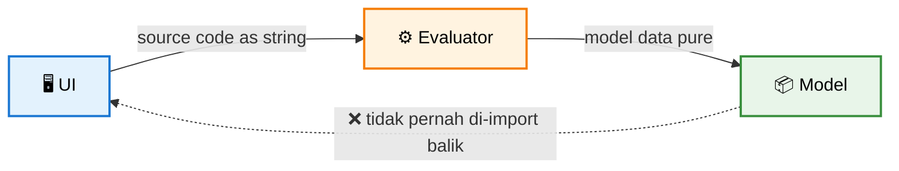
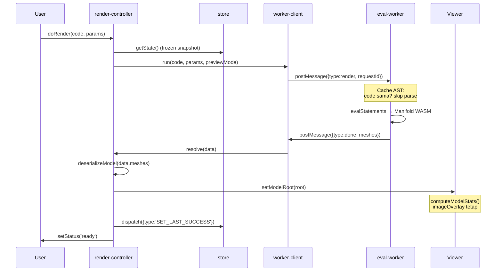
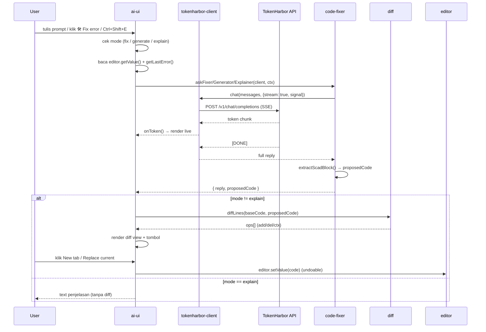
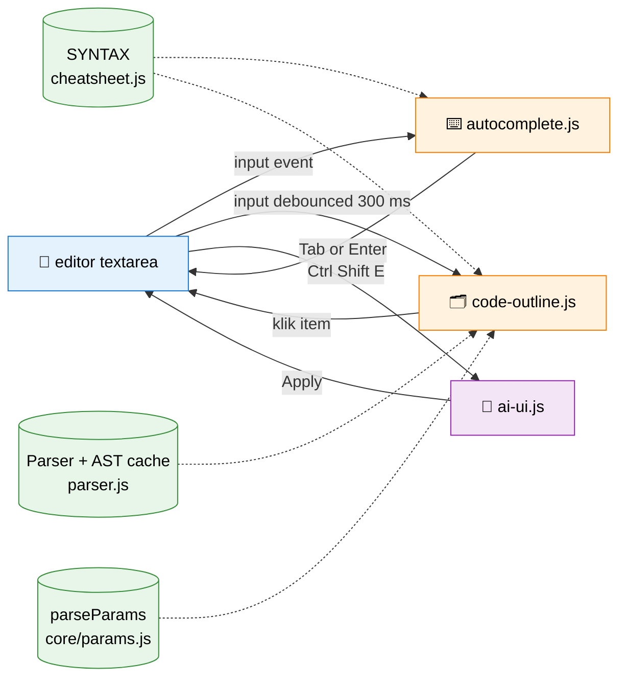
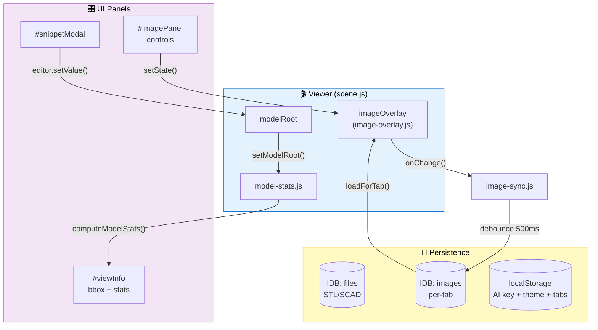
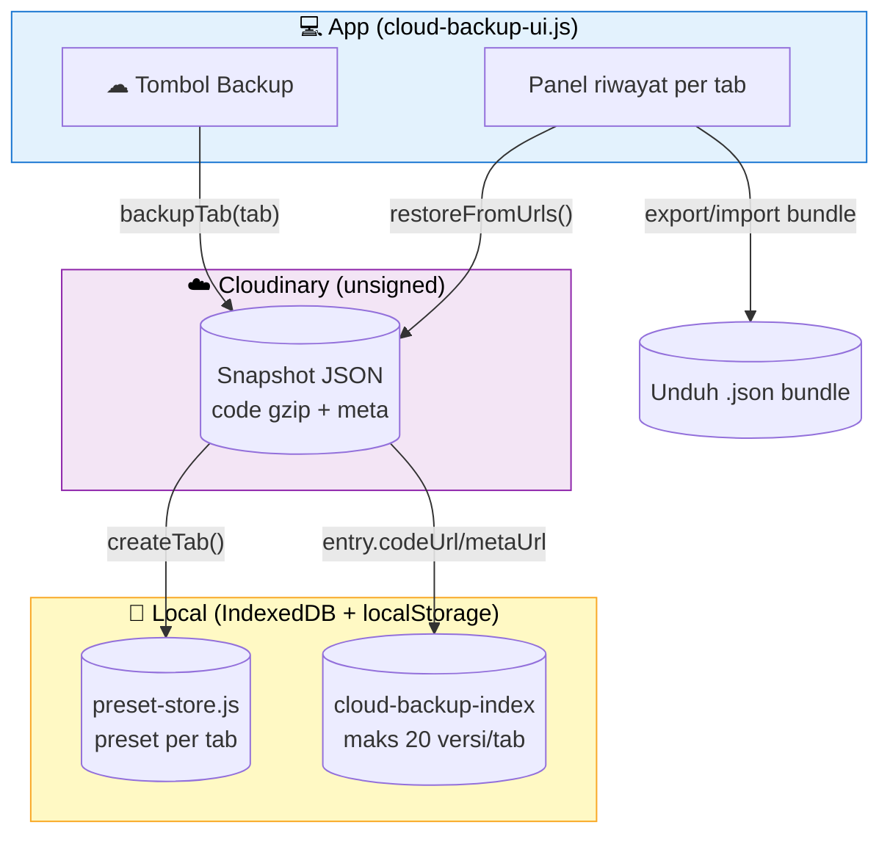

# 🏗️ Arsitektur & Design Principles

> ← Kembali ke [README utama](../README.md) · Lihat juga [rencana-arsitektur-robust.md](./rencana-arsitektur-robust.md) (audit & roadmap)

**Versi dokumen:** 2.1 · **Terakhir diupdate:** 2026-11-20
**Cakupan:** Fase 0–9 (Safety Net → AI Copilot → Editor Intelligence → Content & Reference → Cloud, PWA & Mobile)

---

## 📁 Struktur Proyek

```
mini-open-scad/
├── index.html                    # Entry HTML (+ meta PWA)
├── .github/workflows/ci.yml      # GitHub Actions CI (build + test)
├── public/
│   ├── manifest.json             # PWA web manifest
│   ├── manifold.wasm             # WebAssembly CSG engine
│   ├── icon.svg + *.png          # PWA icons, favicon, screenshots
│   └── libraries/                # Bundled libs (gears.scad, dll)
├── src/
│   ├── main.js                   # Composition Root (~11 KB) — wiring saja
│   ├── api.js                    # Public API stabil (test/integrasi)
│   ├── config.js                 # CONFIG + TIME_BUDGET + AI_CONFIG + CLOUD_CONFIG + PRESETS
│   ├── state.js                  # Facade @deprecated → store/app-store.js
│   ├── storage.js                # localStorage: tabs + tema (migrasi v1→v2→v3 + auto-backup)
│   ├── utils.js                  # SCADError, helpers
│   ├── format.js                 # Auto-formatter OpenSCAD
│   ├── share.js                  # encode/decode share URL (versioned)
│   ├── gif.js                    # GIF encoder wrapper
│   ├── profiler.js               # Performance profiler (+ exportReport)
│   ├── tabs.js                   # TabManager
│   │
│   ├── contract/                 # ✨ [Fase 1] Skema & versi
│   │   └── schemas.js            # STORAGE/SHARE/WORKER schemaVersion
│   │
│   ├── store/                    # ✨ [Fase 2] State management
│   │   ├── app-store.js          # Frozen snapshot + dispatch/subscribe
│   │   └── app-store.test.js     # Unit test (5)
│   │
│   ├── core/                     # Parsing bahasa
│   │   ├── tokenizer.js
│   │   ├── tokenizer.test.js     # Unit test (4)
│   │   ├── parser.js
│   │   ├── scope.js
│   │   ├── params.js             # parse @param annotations
│   │   └── ast-utils.js          # extract import("...")
│   │
│   ├── evaluator/                # Eksekusi AST → geometry
│   │   ├── index.js              # evalExpr, evalStatements (hoisting)
│   │   ├── builtins.js           # module 3D/2D/transform/CSG
│   │   ├── functions.js          # fungsi matematika & data
│   │   ├── geometry.js           # Three.js helpers
│   │   ├── manifold-engine.js    # WebAssembly Manifold-3d
│   │   ├── mesh-utils.js         # Geometry cleaning
│   │   ├── params.js             # applyParams (override AST)
│   │   └── csg.js                # three-bvh-csg (fallback only)
│   │
│   ├── viewer/                   # 3D rendering
│   │   ├── scene.js              # Viewer class (camera, lights, measure, section)
│   │   ├── model.js              # buildModel (+AST cache), serialisasi
│   │   ├── model.test.js         # Golden test 8 preset
│   │   ├── model-stats.js        # ✨ [Fase 8] Volume/area/weight PLA
│   │   │
│   ├── worker/                   # Web Worker (persistent)
│   │   ├── eval-worker.js        # Init sekali, loop render berulang
│   │   └── worker-client.js      # requestId protocol + watchdog
│   │
│   ├── files/                    # Storage layer
│   │   ├── file-store.js         # STL/SCAD IDB (+QuotaExceeded handler)
│   │   ├── image-store.js        # ✨ [Fase 8] Reference image IDB
│   │   ├── bundled-libs.js       # Auto-load .scad bawaan
│   │   ├── cloud-storage.js      # ☁️ Cloudinary backup (snapshot per tab + restore)
│   │   ├── preset-store.js       # 💾 Preset parameter per tab (IndexedDB)
│   │   ├── gzip-utils.js         # Kompresi gzip/base64 (backup + share)
│   │   ├── dxf-to-polygon.js     # Import DXF → polygon
│   │   ├── svg-to-polygon.js     # Import SVG → polygon
│   │   ├── vector-to-code.js     # Konversi vektor → kode SCAD
│   │   └── file-thumbnail.js     # Thumbnail preview file
│   │
│   ├── ai/                       # ✨ [Fase 6] AI Copilot (TokenHarbor)
│   │   ├── tokenharbor-client.js # API client + SSE stream parser
│   │   ├── ai-context.js         # System prompts: fix / generate / explain
│   │   ├── code-fixer.js         # askFixer + askGenerator + askExplainer
│   │   ├── diff.js               # LCS line-based diff (pure)
│   │   └── token-tracker.js      # 🪙 Rate limit (60/menit, 1800/jam) + biaya
│   │
│   ├── utils/                    # Utilitas turunan
│   │   └── suggest.js            # Fuzzy suggest ("did you mean?")
│   │
│   ├── ui/                       # Komponen UI murni
│   │   ├── editor.js
│   │   ├── console.js
│   │   ├── status.js
│   │   ├── params-panel.js
│   │   ├── tabbar.js
│   │   ├── cheatsheet.js         # Export SYNTAX (single source of truth)
│   │   ├── dropdown.js
│   │   ├── home.js
│   │   ├── find-replace.js
│   │   ├── profiler-panel.js
│   │   ├── autocomplete.js       # ✨ [Fase 7] Popup keyword/module
│   │   ├── code-outline.js       # ✨ [Fase 7] Symbol panel (jump-to-line)
│   │   ├── snippets-data.js      # ✨ [Fase 8] 18 template snippet
│   │   ├── file-preview.js       # Pratinjau file import
│   │   └── token-widget.js       # 🪙 Widget statistik AI (token/biaya)
│   │
│   ├── app/                      # ✨ [Fase 2] Composition modules
│   │   ├── error-boundary.js     # Global error handler (safety net)
│   │   ├── render-controller.js  # doRender, scheduleSave, getLastError
│   │   ├── files-ui.js           # STL import + image drop routing
│   │   ├── share-ui.js           # Share modal
│   │   ├── home-ui.js            # Home screen & ZIP loader
│   │   ├── toolbar.js            # Tombol topbar & preset dropdown
│   │   ├── editor-setup.js       # Editor + find-replace + autocomplete + outline
│   │   ├── preview-setup.js      # Preview mode toggle
│   │   ├── tabs-setup.js         # Tab manager wiring + onTabActivated
│   │   ├── boot.js               # Boot app (share URL + home screen)
│   │   ├── shortcuts.js          # Keyboard shortcuts (Ctrl+Enter, F5/F6, dll)
│   │   ├── viewer-tools.js       # Camera, section, measure, lighting, stats
│   │   ├── capture.js            # PNG, GIF, animation
│   │   ├── export-ui.js          # Export dropdown (STL/SCAD/3MF/PDF/dll)
│   │   ├── ai-ui.js              # ✨ [Fase 6] Modal Fix/Generate/Explain
│   │   ├── snippet-ui.js         # ✨ [Fase 8] Modal Library
│   │   ├── image-ui.js           # ✨ [Fase 8] Panel Reference Image
│   │   ├── cloud-backup-ui.js    # ☁️ Panel Cloudinary (backup/restore/export/import)
│   │   ├── import-vector-ui.js   # 📥 Import SVG/DXF ke editor
│   │   ├── preset-ui.js          # 💾 Panel preset parameter per tab
│   │   ├── mobile-ui.js          # 📱 UI mobile (tab bar + menu More)
│   │   └── pwa.js                # 📲 PWA: SW register, install prompt, offline
│   │
│   ├── export.js                 # STL, 3MF, OBJ, GLB, glTF, PLY
│   ├── export-2d.js              # SVG & DXF
│   ├── export-pdf.js             # PDF Blueprint (technical drawing)
│   ├── project-backup.js         # Save/Load project .zip
│   ├── styles.css                # Impor semua partial CSS
│   │
│   ├── styles/                   # CSS partials (_base, _layout, _ai, _pwa, _cloud, dll)
│   │
│   └── assets/
│       └── fonts/                # helvetiker_regular/bold.typeface.json (Three.js)
│
├── docs-md/                      # Dokumentasi Markdown
├── docs-html/                    # Dokumentasi HTML interaktif
└── dist/                         # Hasil build
```

---

## ⚡ Design Principles

> Arsitektur dibangun di atas **13 prinsip**. Prinsip 1–5 adalah fondasi awal; 6–9 hasil audit Fase 0–5; 10–12 adalah AI, editor intelligence, dan fitur visual (Fase 6–8); 13 adalah cloud sync, PWA, dan mobile (Fase 9).

---

### 1. Pure Functions untuk Logika Inti

`tokenize()`, `parse()`, `buildModel()`, dan `diffLines()` adalah **pure functions** — tanpa side effect, tanpa DOM.

- ✅ **Mudah di-test** — input deterministik → output deterministik
- ✅ **Tanpa mocking DOM** — bisa jalan di Node.js
- ✅ **Composable** — output satu fungsi = input berikutnya

---

### 2. UI Tidak Tahu Tentang Bahasa

Layer **evaluator** tidak meng-`import` UI module — ketergantungan satu arah.



---

### 3. Worker Boundary (Persistent)

Worker **persistent** sejak Fase 3 — dibuat sekali, dipakai berulang.

| Aspek           | Implementasi                                   |
| :-------------- | :--------------------------------------------- |
| 🔢 Format       | `Float32Array` (geometry buffer)               |
| 🚚 Transfer     | `postMessage(buf, [buf.buffer])` — zero-copy   |
| 🚫 Shared state | **Tidak ada** — worker stateless per request   |
| 🆔 Protokol     | `requestId` + `type: render/cancel/done/error` |
| ⏱️ Watchdog     | Dihitung dari `TIME_BUDGET`                    |
| ❌ Cancel       | Kooperatif — cek `cancelFlag` antar iterasi    |

> 💡 Worker kirim `{ type: 'ready' }` sekali setelah `initManifold()` + `preloadOpenTypeFonts()`.

---

### 4. Data-Driven UI

Form control **di-generate dinamis** dari metadata di kode.

```scad
// @param radius {slider 1 100 10} Radius
// @param height {slider 1 200 20} Height
```

- 📝 Parser baca komentar `@param`
- 🎛️ Form di-render otomatis — tanpa hardcode
- ➕ Tambah parameter = tambah komentar, **tanpa sentuh UI**

Data-driven diperluas di Fase 7: **autocomplete** dan **code-outline** juga membaca dari `SYNTAX` (cheatsheet.js) — single source of truth.

---

### 5. Graceful Degradation

Kegagalan tidak boleh membuat aplikasi crash.

| Kegagalan                 | Perilaku Sistem                                         |
| :------------------------ | :------------------------------------------------------ |
| ⚠️ CSG gagal              | Warning → render **parsial** (shape valid tetap muncul) |
| 🔄 Worker gagal           | Fallback ke eksekusi **sync** di main thread            |
| 💾 Storage penuh          | Toast actionable ("hapus project lama")                 |
| 🌐 Share version mismatch | Toast "link dari versi lebih baru"                      |
| 🤖 AI tanpa key           | Toast + buka settings panel, tidak crash                |
| 🖼️ Image load gagal       | Toast, editor tidak terpengaruh                         |

> Prinsip: **partial success > total failure**.

---

### 6. Explicit Contract (Fase 1) ✨

Setiap lintas-batas punya skema berversi + validator.

```js
// src/contract/schemas.js
export const WORKER_PROTOCOL_VERSION = 2;
export const STORAGE_SCHEMA_VERSION = 3;
export const SHARE_SCHEMA_VERSION = 2;
```

**Manfaat:** User data tidak hilang diam-diam; link share dari versi lebih baru ditolak dengan pesan ramah.

---

### 7. Single Source of Truth (Fase 2) ✨

Satu `store` untuk state; satu `TIME_BUDGET` untuk waktu; satu `AI_CONFIG` untuk AI; satu `SYNTAX` untuk autocomplete + cheatsheet + outline.

```js
// src/store/app-store.js — snapshot frozen
const snapshot = store.getState();
snapshot.autoRender = false; // ❌ TypeError: object is frozen
store.dispatch({ type: "SET_AUTO_RENDER", payload: false }); // ✅
```

```js
// src/config.js
export const TIME_BUDGET = {
  evalDefaultMs: 15000,
  evalHardCapMs: 120000,
  watchdogGraceMs: 5000,
};
export const AI_CONFIG = {
  baseURL: "https://tokenharbor.ai/v1",
  model: "deepseek-v4.1-flash:free",
  keyStorage: "mini-openscad-tokenharbor-key",
  maxTokens: 8192,
};
```

---

### 8. Fail Loud at Build, Quiet at Runtime (Fase 5) ✨

| Lapisan      | Perilaku                                                               |
| :----------- | :--------------------------------------------------------------------- |
| **Build/CI** | `npm run build` gagal jika import rusak; `npm test` gagal jika regresi |
| **Runtime**  | Error async ditangkap `error-boundary.js` → toast + log                |
| **Contract** | Payload worker divalidasi; versi tak dikenal → error terklasifikasi    |

---

### 9. Composition Root yang Dapat Diuji (Fase 2) ✨

`main.js` hanya merangkai; setiap fitur didaftarkan lewat `init*()`. Prinsip diperluas di Fase 6–8: **AI, snippet, image, stats** semuanya modul baru yang tinggal di-`init*()` tanpa ubah core render.

```js
// src/main.js (~11 KB) — hanya wiring
const renderController = initRenderController({ editor, viewer, workerClient, ... });
const { editor, findReplace, autocomplete, codeOutline } = setupEditor({ ... });
initToolbar({ ... });
initAIUI({ editor, tabManager, getLastError: renderController.getLastError, ... });
initSnippetUI({ editor, tabManager, ... });
initImageUI({ viewer, tabManager, imageSync });
```

**Manfaat:** Fitur baru = tambah satu file `app/*.js` + satu baris `init*()`.

---

### 10. AI as Opt-in Copilot (Fase 6) ✨

AI integration dirancang **tidak pernah mengganggu** core render path, **tidak menyimpan secret di bundle**, dan **selalu abortable**.

| Aspek               | Implementasi                                                          |
| :------------------ | :-------------------------------------------------------------------- |
| 🔑 API key          | `localStorage` (paste sendiri via ⚙ Settings) — **tidak** hardcode    |
| 🚫 Bundle secret    | Zero — `process.env` tidak dipakai (browser)                          |
| 📡 Transport        | Native `fetch` + SSE parser (~30 baris, tanpa SDK `openai` ~50 KB)    |
| ❌ Abort            | `AbortController` — tutup modal / Esc → request cancel                |
| 🔒 Error clarity    | 401 → "key ditolak", 429 → "rate limit 60/min", 4xx → detail dari API |
| 📉 Graceful degrade | Tanpa key → fitur disable + settings UI, core app tetap normal        |

---

### 11. Progressive Enhancement (Fase 6–8) ✨

Semua fitur baru **opt-in** dan **tidak memblokir** fitur lama. Kalau user tidak aktifkan, aplikasi tetap berfungsi seperti sebelumnya.

| Fitur               | Default state                       | Blocking? |
| :------------------ | :---------------------------------- | :-------- |
| **AI Copilot**      | Hidden (butuh key)                  | ❌        |
| **Autocomplete**    | Aktif saat mengetik (bisa di-`Esc`) | ❌        |
| **Code Outline**    | Hidden (toggle button)              | ❌        |
| **Snippet Library** | Hidden (modal)                      | ❌        |
| **Image Overlay**   | Hidden (toggle button)              | ❌        |
| **Model Stats**     | Tampil bbox only (extend = toggle)  | ❌        |

> Prinsip: tidak ada regresi behavior. Setiap fitur baru = additive, bukan replacement.

---

### 12. User Consent for Destructive Actions (Fase 6) ✨

AI dan tools **tidak pernah mengganti kode tanpa review**.

| Aksi                   | Gate                                                                                      |
| :--------------------- | :---------------------------------------------------------------------------------------- |
| **AI Apply / Replace** | Diff view tampil dulu; user klik Apply secara eksplisit                                   |
| **Editor drift**       | Kalau editor berubah sejak AI membaca → `confirm()`                                       |
| **Snippet Use**        | Kalau editor non-empty → `confirm()`                                                      |
| **AI Generate**        | Tombol **New tab** (primary) sebelum **Replace current**                                  |
| **Image delete**       | `confirm()`                                                                               |
| **Undo friendly**      | Semua replacement via `editor.setValue()` (recordHistory=true) → **Ctrl+Z** mengembalikan |

---

### 13. Offline-First & Cloud Sync (PWA) ✨

Aplikasi berjalan sepenuhnya offline setelah first load, dengan opsi sinkronisasi cloud berbasis user consent.

| Aspek               | Implementasi                                                          |
| :------------------ | :-------------------------------------------------------------------- |
| 📲 PWA              | Service Worker (vite-plugin-pwa) + install prompt + update banner     |
| 📴 Offline          | Semua aset di-cache; worker + render berjalan tanpa jaringan          |
| ☁️ Cloud Backup     | Cloudinary unsigned upload — snapshot per tab, index di localStorage  |
| 🔐 Consent          | Backup tidak otomatis ke cloud tanpa aksi user; tidak ada secret di bundle |
| 📱 Mobile           | Tab bar diperbaiki + menu "More" (⋮) untuk layar ≤ 768px              |
| 🪙 Token tracking   | Rate limit AI (60/menit, 1800/jam) + biaya per model disimpan lokal   |

---

## 🔄 Roadmap & Fase Arsitektur

Dokumen lengkap audit & roadmap ada di [rencana-arsitektur-robust.md](./rencana-arsitektur-robust.md).

| Fase  | Fokus                     | Status | Highlight                                      |
| :---: | :------------------------ | :----: | :--------------------------------------------- |
|   0   | Safety Net                |   ✅   | Error Boundary + Vitest + CI                   |
|   1   | Kontrak & Versioning      |   ✅   | Storage/Share/Worker versioned                 |
|   2   | State Store & Decouple    |   ✅   | app-store + 10 modul `app/*`                   |
|   3   | Worker Persistent         |   ✅   | Worker dibuat sekali, -200ms/render            |
|   4   | Performa & Resiliensi     |   ✅   | AST cache, debounce, quota handling            |
|   5   | Observability & Docs Sync |   ✅   | `api.js`, render report, docs test             |
| **6** | **AI Copilot**            |   ✅   | TokenHarbor + Fix/Generate/Explain + Diff view |
| **7** | **Editor Intelligence**   |   ✅   | Autocomplete + Code Outline                    |
| **8** | **Content & Reference**   |   ✅   | Snippet Library + Image Overlay + Model Stats  |
| **9** | **Cloud, PWA & Mobile**   | 🚀   | Cloudinary backup + PWA offline + Mobile UI + Token tracker + Preset per tab |

### Pencapaian Terukur

| Metrik                 |     Sebelum     |                                      Sesudah                                       |
| :--------------------- | :-------------: | :--------------------------------------------------------------------------------: |
| `main.js`              |      23 KB      |                                     **~11 KB**                                     |
| Worker per render      |     1 baru      |                                  **1 persistent**                                  |
| Parse saat slider drag |   Setiap kali   |                                   **Cache AST**                                    |
| Test otomatis          |        0        |                 **21 tests** (tokenizer, model, store, api, docs)                  |
| CI                     |       ❌        |                                 ✅ GitHub Actions                                  |
| Error async            |   Hilang diam   |                                 **Error Boundary**                                 |
| State mutation         |    Tersebar     |                               **Frozen + dispatch**                                |
| Storage schema         | Tidak versioned |                                **v3 + auto-backup**                                |
| Modul `app/*`          |       10        | **22** (+cloud-backup-ui, +import-vector-ui, +preset-ui, +mobile-ui, +pwa dan lainnya) |
| UI features            |       10        | **20+** (+AI, +autocomplete, +outline, +snippet, +image, +stats, +cloud backup, +preset, +mobile, +PWA) |
| AI capabilities        |        —        |                       **3 mode** (Fix · Generate · Explain)                        |

---

## 🧭 Alur Render Pipeline (Core — Tidak Berubah)



---

## 🤖 Alur AI Copilot Pipeline (Fase 6)



**Prinsip yang dijaga:**

- Semua aksi AI **tidak langsung modifikasi editor** — lewat review/diff dulu
- Streaming → user lihat respons muncul real-time (feedback instan)
- `AbortController` → tutup modal = request batal, tidak boros token
- Error HTTP (401, 429) → toast spesifik, bukan generic

---

## 🧠 Editor Intelligence Pipeline (Fase 7)



**Single source of truth dipertahankan:**

- `SYNTAX` di `cheatsheet.js` → dipakai cheatsheet, autocomplete, code-outline (semua lihat daftar module yang sama)
- `Parser` + `parseParams` → tidak ada parser duplikat; code-outline pakai yang sama dengan evaluator
- Semua input transformasi **balik ke editor textarea** → undo/redo tetap native

---

## 🖼️ Reference & Analytics Layer (Fase 8)



**Isolasi yang dijaga:**

- **`modelRoot`** = hanya mesh hasil render (dipakai export STL/3MF/OBJ)
- **`imageOverlay`** = mesh di scene **di luar** `modelRoot` → **tidak** ikut export, **tidak** ikut bbox, **tidak** ikut CSG
- **Model stats** dihitung saat `setModelRoot` (sekali per render) → tidak block interaksi
- **Image persistence** per tab ID → tidak ada cross-contamination antar tab

---

## ☁️ Cloud Backup & Sync Layer (Fase 9)

Backup snapshot per tab ke **Cloudinary** (unsigned upload → tidak ada secret di bundle). Setiap save = file baru dengan timestamp; index versi disimpan di localStorage (maks 20 versi/tab).



**Jaminan keamanan:**
- Tidak ada API key di bundle — upload pakai `upload_preset` Cloudinary (unsigned).
- Setiap upload = file baru (`public_id` ber-timestamp), tidak overwrite.
- Restore → tab baru (+ migrasi preset ke tabId baru), tidak menimpa tab aktif.
- Bundle export/import memungkinkan pindah antar device.

---

## 🪙 Token Tracking & Rate Limit (AI)

`src/ai/token-tracker.js` mencatat setiap request AI di localStorage (`mini-openscad-ai-stats`):

| Metrik              | Detail                                                          |
| :------------------ | :-------------------------------------------------------------- |
| Rate limit          | 60 request/menit, 1800 request/jam (TokenHarbor free tier)      |
| Penyimpanan         | Rolling window 60s / 3600s; breakdown per hari (30 hari terakhir) |
| Biaya               | Estimasi USD per model (deepseek-v4.1-flash dll.)               |
| Reset               | Manual via `resetStats()`                                       |
| Tampilan            | `ui/token-widget.js` — ringkas token + biaya di UI              |

---

## 💾 Preset Parameter per Tab

`src/files/preset-store.js` (IndexedDB `mini-openscad-presets`) menyimpan daftar preset parameter (`{name, values, createdAt, updatedAt}`) per `tabId`. Preset ikut disertakan dalam cloud backup snapshot dan dapat dipulihkan bersama tab.

---

## 📱 PWA & Mobile UI

- **PWA** (`src/app/pwa.js`): Service Worker terdaftar dengan update check per jam, tombol Install, banner versi baru, indikator online/offline.
- **Mobile** (`src/app/mobile-ui.js`): Tab bar Code/3D/Console diperbaiki; tombol jarang dipakai dipindah ke menu "More" (⋮) pada layar ≤ 768px.

---

## 🛡️ Contract & Boundary Rules

Ringkasan lintas-batas yang **wajib** dijaga:

| Boundary                   | Boleh lewat                                | Dilarang lewat                         |
| :------------------------- | :----------------------------------------- | :------------------------------------- |
| **Main → Worker**          | `Float32Array`, code string, `paramValues` | Objek DOM, closure, `THREE.Mesh`       |
| **Editor → Evaluator**     | Kode string                                | Objek editor, state UI                 |
| **AI → Editor**            | Kode string via `setValue()`               | Mutasi langsung `editor.value`         |
| **Image → Model**          | Tidak ada (terpisah)                       | Reference image di `modelRoot`         |
| **AI key**                 | `localStorage` user                        | Bundled code, Git repo, shared URL     |
| **Render output → Export** | `viewer.modelRoot`                         | `viewer.imageOverlay`, `_measureGroup` |
| **Cloud Backup → App**     | JSON snapshot via `restoreFromUrls()`      | File mentah di luar skema snapshot     |
| **App → Cloudinary**       | Snapshot ter-encode (code + meta + presets)| `upload_preset` / secret API key       |
| **AI Tracker → localStorage**| Statistik token + biaya per hari         | Isi prompt atau kode ASLI user         |

---

## 📚 Referensi Dokumen Lain

- [README utama](../README.md) — Overview & quick start
- [rencana-arsitektur-robust.md](./rencana-arsitektur-robust.md) — Audit lengkap & roadmap detail
- [api.md](./api.md) — Public API stabil (`src/api.js`)
- [parameters.md](./parameters.md) — `@param` annotation reference
- [AI_SETUP.md](./AI_SETUP.md) — Cara setup TokenHarbor key & mode AI

---

> ← Kembali ke [README utama](../README.md) · [rencana-arsitektur-robust.md](./rencana-arsitektur-robust.md)

---
